# Administración de Base de Datos II — Evaluación Unidad 2
# Base de Datos Empresarial: Administrada, Optimizada y Asegurada
## Proyecto: ERP JD Refrigeración S.A.C.

Este documento presenta la implementación técnica y justificación de los 5 pilares de administración de base de datos empresarial aplicados al sistema ERP de **JD Refrigeración S.A.C.** sobre **Oracle Database 21c Express Edition**. Los scripts de configuración fueron ejecutados desde Oracle SQL Developer con la cuenta de alta administración `SYS AS SYSDBA` sobre el pluggable database `XEPDB1`, asegurando y optimizando el esquema operacional `jdrefrigeracion`.

---

## Participantes del Proyecto

* **[Apaza Mamani Wilson Ronald]**
* **[Magaño Quispe Aron Rodrigo]**
* **[Chambi Sirena Yoel Wagner]**

---

## Arquitectura General del Proyecto

| Componente | Tecnología | Detalle Implementado |
|---|---|---|
| Motor de Base de Datos | Oracle Database 21c XE | Contenedor Pluggable: `XEPDB1` |
| Herramienta de Administración | Oracle SQL Developer | Conexión privilegiada: `Admin_Local` (`SYS AS SYSDBA`) |
| Esquema Propietario | `jdrefrigeracion` | 16 tablas relacionales, procedimientos, funciones y triggers |
| Particionamiento Físico | 3 tablas centrales | `VENTAS` (Range), `PROFORMAS` (List), `COMPRAS` (Hash) |
| Tablespaces de Negocio | 4 tablespaces dedicados | `TS_JD_DATA`, `TS_JD_INDICES`, `TS_JD_MAESTROS`, `TS_JD_TEMP` |
| Usuarios Nominales | 3 cuentas nominales | `lisandro_admin`, `lucy_ventas`, `jd_reportes` |
| Roles de Negocio | 2 roles RBAC principales | `ROL_JD_ADMIN` (Gerencia), `ROL_JD_ASISTENTE` (Ventas) |
| Auditoría Unificada | 5 políticas unificadas | Sesiones, Ventas, Pagos/Caja, Catálogos Maestros y DDL |
| Repositorio AWR | Workload Repository | Diagnóstico de rendimiento, snapshots y análisis de Top SQL |

---

## MÓDULO 1 — TABLESPACES
### Almacenamiento Físico Separado por Tipo de Dato
**Script de referencia:** `S2_01_tablespaces.sql`  
**Conexión requerida:** `Admin_Local` (`SYS AS SYSDBA`)

Para superar las limitaciones de una base de datos monolítica donde todos los objetos compiten en el tablespace genérico `USERS`, se diseñó una arquitectura de almacenamiento físico segmentada en cuatro tablespaces independientes. Esto previene la fragmentación de bloques, permite políticas de respaldo selectivas y aísla el I/O de disco entre operaciones transaccionales, consultas de catálogos y reconstrucción de índices.

| Tablespace | Tipo | Archivo Datafile | Tamaño Inicial | Autoextensión | Propósito de Negocio |
|---|---|---|---|---|---|
| `TS_JD_DATA` | PERMANENT | `jd_data01.dbf` | 50 MB | +10 MB (Máx 500 MB) | Tablas transaccionales de alto movimiento (`VENTAS`, `COMPRAS`, `PAGOS`) |
| `TS_JD_INDICES` | PERMANENT | `jd_indices01.dbf` | 30 MB | +5 MB (Máx 200 MB) | Almacenamiento exclusivo de índices B-Tree y llaves foráneas |
| `TS_JD_MAESTROS` | PERMANENT | `jd_maestros01.dbf` | 20 MB | +5 MB (Máx 100 MB) | Catálogos maestros de consulta frecuente (`CLIENTES`, `PRODUCTOS`) |
| `TS_JD_TEMP` | TEMPORARY | `jd_temp01.dbf` | 20 MB | +5 MB (Máx 100 MB) | Área de ordenamiento (`SORT`), agrupaciones y `HASH JOINS` |

---

### Paso 1.1: Creación DDL de Tablespaces y Datafiles
Se definieron los archivos de datos físicos especificando gestión de extensiones local (`EXTENT MANAGEMENT LOCAL`) y asignación automática de segmentos (`SEGMENT SPACE MANAGEMENT AUTO`):

```sql
-- Creación de tablespaces transaccional, índices, maestros y temporal
CREATE TABLESPACE TS_JD_DATA
    DATAFILE 'C:\APP\WIGETTA\PRODUCT\21C\ORADATA\XE\XEPDB1\jd_data01.dbf'
    SIZE 50M AUTOEXTEND ON NEXT 10M MAXSIZE 500M
    EXTENT MANAGEMENT LOCAL AUTOALLOCATE SEGMENT SPACE MANAGEMENT AUTO;

CREATE TABLESPACE TS_JD_INDICES
    DATAFILE 'C:\APP\WIGETTA\PRODUCT\21C\ORADATA\XE\XEPDB1\jd_indices01.dbf'
    SIZE 30M AUTOEXTEND ON NEXT 5M MAXSIZE 200M
    EXTENT MANAGEMENT LOCAL AUTOALLOCATE SEGMENT SPACE MANAGEMENT AUTO;

CREATE TABLESPACE TS_JD_MAESTROS
    DATAFILE 'C:\APP\WIGETTA\PRODUCT\21C\ORADATA\XE\XEPDB1\jd_maestros01.dbf'
    SIZE 20M AUTOEXTEND ON NEXT 5M MAXSIZE 100M
    EXTENT MANAGEMENT LOCAL AUTOALLOCATE SEGMENT SPACE MANAGEMENT AUTO;

CREATE TEMPORARY TABLESPACE TS_JD_TEMP
    TEMPFILE 'C:\APP\WIGETTA\PRODUCT\21C\ORADATA\XE\XEPDB1\jd_temp01.dbf'
    SIZE 20M AUTOEXTEND ON NEXT 5M MAXSIZE 100M;
```

> **Figura 1.1 — Creación exitosa de los 4 Tablespaces**  
> *Script:* `S2_01_tablespaces.sql` (Líneas 1-35) | *Evidencia:* Salida de script de SQL Developer con los 4 mensajes de confirmación `Tablespace created.`.  
> 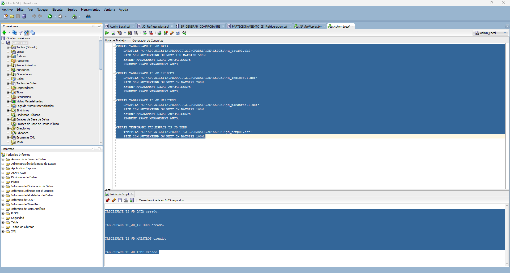

---

### Paso 1.2: Verificación en el Diccionario de Datos (`DBA_TABLESPACES`)
Se consultó el catálogo maestro de almacenamiento de Oracle para validar el estado operativo (`ONLINE`), tipo de contenido y método de gestión de los nuevos tablespaces:

```sql
SELECT tablespace_name, status, contents, extent_management, allocation_type
FROM   dba_tablespaces
WHERE  tablespace_name LIKE 'TS_JD%'
ORDER  BY tablespace_name;
```

> **Figura 1.2 — Auditoría de Tablespaces en DBA_TABLESPACES**  
> *Script:* `S2_01_tablespaces.sql` | *Evidencia:* Cuadrícula de datos confirmando estado `ONLINE` y tipo `PERMANENT`/`TEMPORARY` para cada tablespace del proyecto.  
> 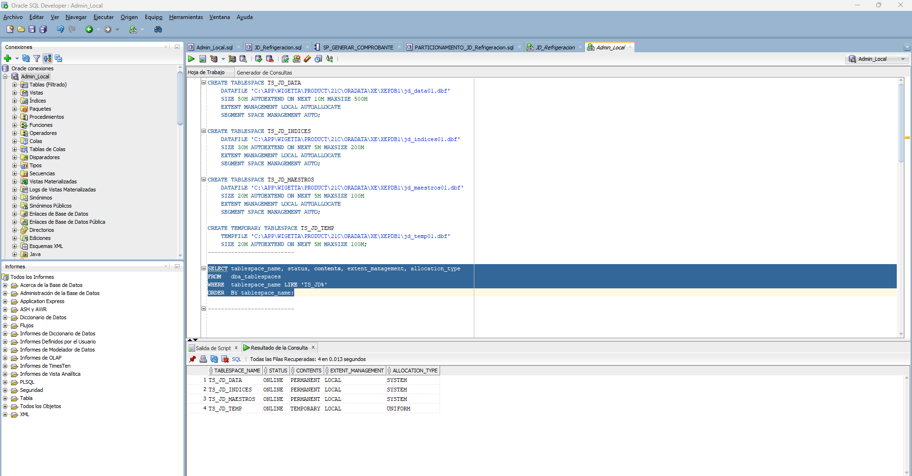

---

### Paso 1.3: Inspección de Archivos Físicos (`DBA_DATA_FILES`)
Se constató la asignación de espacio en el sistema de archivos del sistema operativo Windows y la activación de autoextensión para evitar detenciones por falta de almacenamiento:

```sql
SELECT file_name, tablespace_name,
       ROUND(bytes/1024/1024, 0)    AS size_mb,
       autoextensible,
       ROUND(maxbytes/1024/1024, 0) AS max_mb
FROM   dba_data_files
WHERE  tablespace_name LIKE 'TS_JD%'
ORDER  BY tablespace_name;
```

> **Figura 1.3 — Verificación de Datafiles en DBA_DATA_FILES**  
> *Script:* `S2_01_tablespaces.sql` | *Evidencia:* Confirmación de los archivos `.dbf` en `C:\APP\WIGETTA\...` con propiedad `AUTOEXTENSIBLE = YES`.  
> 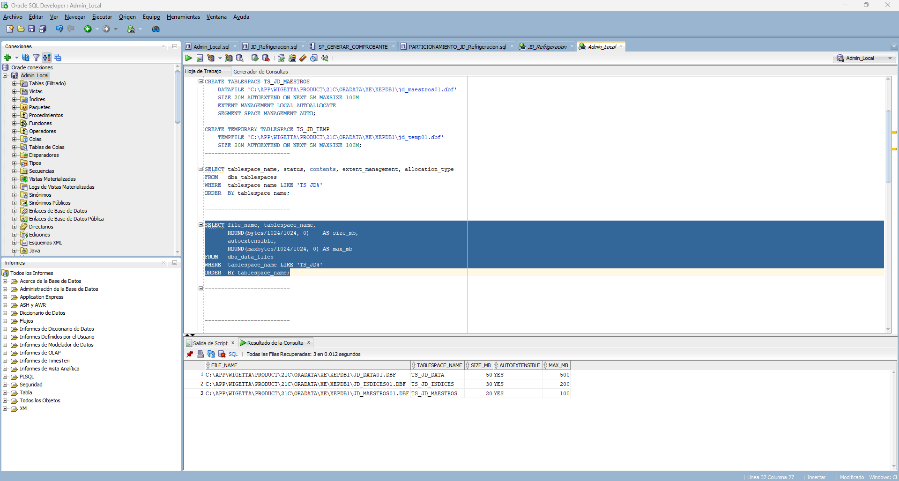

---

### Paso 1.4: Asignación de Cuotas y Reasignación de Tablespace por Defecto
Se restringió el tablespace `USERS` asignando cuota 0, se otorgó cuota ilimitada en los tablespaces empresariales y se reasignó el tablespace por defecto del usuario `jdrefrigeracion`:

```sql
ALTER USER jdrefrigeracion QUOTA UNLIMITED ON TS_JD_DATA;
ALTER USER jdrefrigeracion QUOTA UNLIMITED ON TS_JD_INDICES;
ALTER USER jdrefrigeracion QUOTA UNLIMITED ON TS_JD_MAESTROS;
ALTER USER jdrefrigeracion QUOTA 0         ON USERS;

ALTER USER jdrefrigeracion
    DEFAULT   TABLESPACE TS_JD_DATA
    TEMPORARY TABLESPACE TS_JD_TEMP;

SELECT username, default_tablespace, temporary_tablespace, profile
FROM   dba_users
WHERE  username = 'JDREFRIGERACION';
```

> **Figura 1.4 — Configuración de Tablespace y Cuotas del Usuario Propietario**  
> *Script:* `S2_01_tablespaces.sql` | *Evidencia:* Consulta a `DBA_USERS` verificando `DEFAULT_TABLESPACE = TS_JD_DATA` y `TEMPORARY_TABLESPACE = TS_JD_TEMP`.  
> 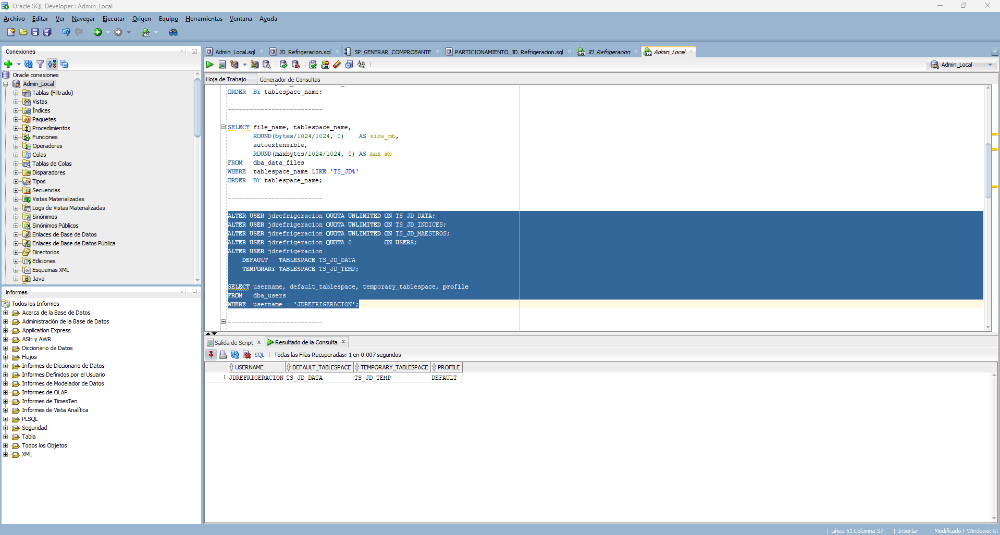

---

## MÓDULO 2 — USUARIOS Y ROLES
### Seguridad de Acceso por Rol de Negocio (RBAC)
**Script de referencia:** `S2_02_usuarios_roles.sql`  
**Conexión requerida:** `Admin_Local` (`SYS AS SYSDBA`)

Bajo el estándar de seguridad industrial y el Principio de Menor Privilegio (*Principle of Least Privilege*), se eliminó el uso de cuentas genéricas compartidas. Se creó un perfil de seguridad corporativo con políticas estrictas de contraseñas, roles basados en las funciones del ERP (Gerencia y Ventas) y cuentas nominales individuales.

| Rol | Usuario Asignado | Cargo / Perfil | Alcance de Privilegios |
|---|---|---|---|
| `ROL_JD_ADMIN` | `lisandro_admin` | Lisandro (Gerente General) | Control total (DDL, DML, pagos, compras, reportes y ejecución de procedures) |
| `ROL_JD_ASISTENTE` | `lucy_ventas` | Lucy (Atención / Ventas) | Operación de ventas, proformas, clientes y pagos. Sin permiso de eliminación (`DELETE`) |
| *(Directo)* | `jd_reportes` | Auditoría / BI | Conexión de solo lectura (`SELECT`) sobre tablas principales |

---

### Paso 2.1: Perfil de Contraseña Segura (`PERFIL_JD_SEGURO`)
Se implementaron directivas de seguridad para mitigar ataques de fuerza bruta y abandono de terminales desatendidas:

```sql
CREATE PROFILE PERFIL_JD_SEGURO LIMIT
    FAILED_LOGIN_ATTEMPTS   3          -- Bloqueo de cuenta tras 3 intentos erróneos
    PASSWORD_LOCK_TIME      1/24       -- Tiempo de bloqueo: 1 hora
    PASSWORD_LIFE_TIME      90         -- Rotación obligatoria cada 90 días
    PASSWORD_REUSE_TIME     365        -- Prohibido reusar contraseñas durante 1 año
    PASSWORD_REUSE_MAX      5          -- Historial de las últimas 5 claves
    PASSWORD_GRACE_TIME     7          -- 7 días de gracia tras caducidad
    SESSIONS_PER_USER       3          -- Máximo 3 sesiones simultáneas
    IDLE_TIME               30         -- Desconexión automática tras 30 min de inactividad
    CONNECT_TIME            480;       -- Duración máxima de jornada: 8 horas (480 min)
```

> **Figura 2.1 — Parámetros del Perfil PERFIL_JD_SEGURO**  
> *Script:* `S2_02_usuarios_roles.sql` | *Evidencia:* Consulta a `DBA_PROFILES` mostrando los límites configurados contra ataques de fuerza bruta.  
> 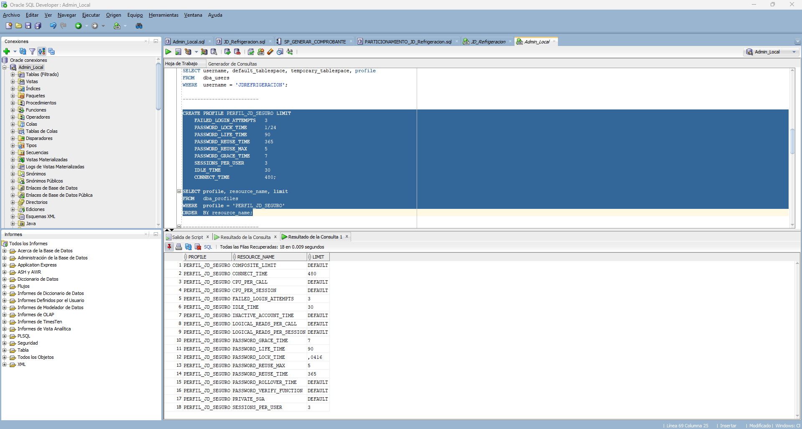

---

### Paso 2.2: Creación de Roles de Negocio
Se definieron los roles estructurados del sistema en Oracle Database:

```sql
CREATE ROLE ROL_JD_ADMIN;
CREATE ROLE ROL_JD_ASISTENTE;

SELECT role FROM dba_roles WHERE role LIKE 'ROL_JD%' ORDER BY role;
```

> **Figura 2.2 — Roles Empresariales Creados en DBA_ROLES**  
> *Script:* `S2_02_usuarios_roles.sql` | *Evidencia:* Cuadrícula mostrando los roles `ROL_JD_ADMIN` y `ROL_JD_ASISTENTE`.  
> 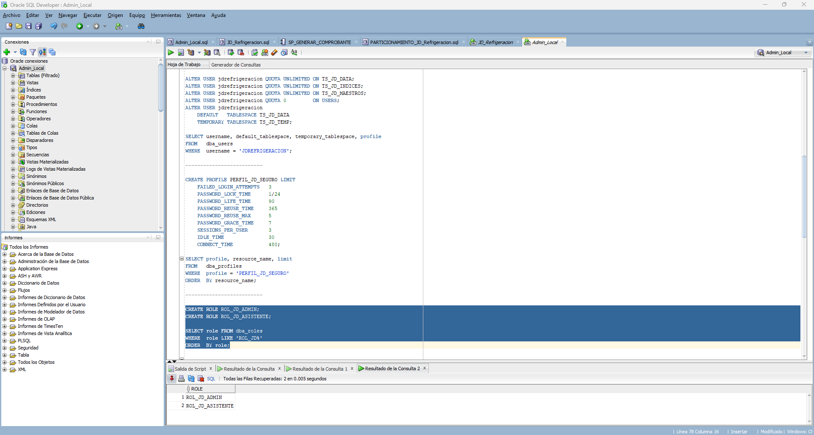

---

### Paso 2.3: Creación de Cuentas Nominales
Se crearon las cuentas para el personal del negocio, asignándoles el tablespace de datos, tablespace temporal y el perfil de contraseñas seguras:

```sql
CREATE USER lisandro_admin IDENTIFIED BY "JDRefri@Admin2026"
    DEFAULT TABLESPACE TS_JD_DATA TEMPORARY TABLESPACE TS_JD_TEMP
    PROFILE PERFIL_JD_SEGURO ACCOUNT UNLOCK;

CREATE USER lucy_ventas IDENTIFIED BY "JDRefri@Lucy2026"
    DEFAULT TABLESPACE TS_JD_DATA TEMPORARY TABLESPACE TS_JD_TEMP
    PROFILE PERFIL_JD_SEGURO ACCOUNT UNLOCK;

CREATE USER jd_reportes IDENTIFIED BY "JDRefri@Report2026"
    DEFAULT TABLESPACE TS_JD_DATA TEMPORARY TABLESPACE TS_JD_TEMP
    PROFILE PERFIL_JD_SEGURO ACCOUNT UNLOCK;
```

> **Figura 2.3 — Usuarios Nominales Activos en DBA_USERS**  
> *Script:* `S2_02_usuarios_roles.sql` | *Evidencia:* Consulta a `DBA_USERS` verificando cuentas con estado `OPEN` y perfil asignado.  
> 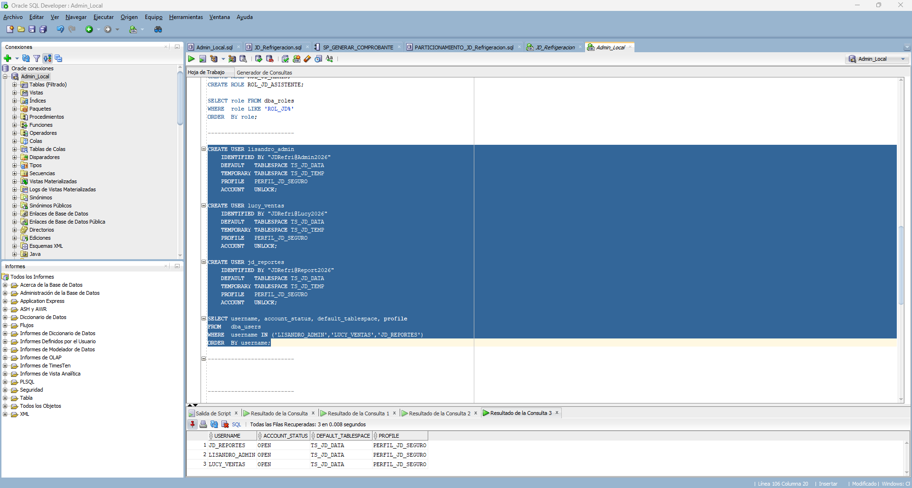

---

### Paso 2.4: Asignación de Roles a Usuarios (`DBA_ROLE_PRIVS`)
Se asociaron los roles de negocio correspondientes a cada colaborador:

```sql
GRANT CONNECT, RESOURCE TO ROL_JD_ADMIN;
GRANT CONNECT           TO ROL_JD_ASISTENTE;

GRANT ROL_JD_ADMIN     TO lisandro_admin;
GRANT ROL_JD_ASISTENTE TO lucy_ventas;
GRANT CONNECT, CREATE SESSION TO jd_reportes;

SELECT grantee, granted_role, admin_option
FROM   dba_role_privs
WHERE  grantee IN ('LISANDRO_ADMIN','LUCY_VENTAS','JD_REPORTES')
ORDER  BY grantee;
```

> **Figura 2.4 — Mapeo de Roles a Cuentas en DBA_ROLE_PRIVS**  
> *Script:* `S2_02_usuarios_roles.sql` | *Evidencia:* Verificación de que `lisandro_admin` posee `ROL_JD_ADMIN` y `lucy_ventas` posee `ROL_JD_ASISTENTE`.  
> 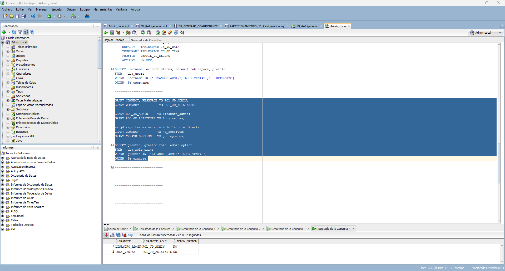

---

### Paso 2.5: Concesión de Privilegios de Objeto Granulares (`DBA_TAB_PRIVS`)
Se implementó el Principio de Menor Privilegio otorgando permisos diferenciados: `lucy_ventas` puede registrar y actualizar ventas, pero no tiene privilegios para eliminar (`DELETE`), previniendo alteraciones o pérdidas de transacciones:

```sql
GRANT SELECT, INSERT, UPDATE ON jdrefrigeracion.ventas            TO ROL_JD_ASISTENTE;
GRANT SELECT, INSERT, UPDATE ON jdrefrigeracion.proformas         TO ROL_JD_ASISTENTE;
GRANT SELECT, INSERT, UPDATE ON jdrefrigeracion.clientes          TO ROL_JD_ASISTENTE;
GRANT SELECT, INSERT         ON jdrefrigeracion.pagos             TO ROL_JD_ASISTENTE;
GRANT SELECT, INSERT         ON jdrefrigeracion.pago_ventas       TO ROL_JD_ASISTENTE;
GRANT SELECT                 ON jdrefrigeracion.productos         TO ROL_JD_ASISTENTE;
GRANT SELECT                 ON jdrefrigeracion.categorias        TO ROL_JD_ASISTENTE;
GRANT EXECUTE ON jdrefrigeracion.SP_GENERAR_COMPROBANTE           TO ROL_JD_ASISTENTE;
```

> **Figura 2.5 — Privilegios de Objeto Granulares en DBA_TAB_PRIVS**  
> *Script:* `S2_02_usuarios_roles.sql` | *Evidencia:* Detalle de permisos por tabla confirmando que la asistente no posee privilegios `DELETE`.  
> 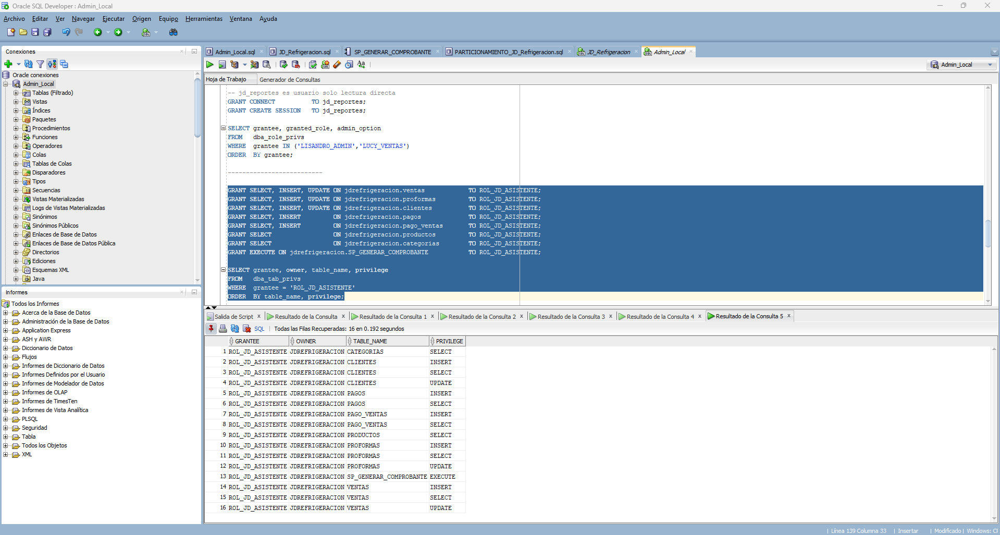

---

## MÓDULO 3 — AUDITORÍA
### Oracle Unified Auditing — Trazabilidad de Operaciones Críticas
**Script de referencia:** `S2_03_auditoria.sql`  
**Conexiones:** `Admin_Local` (Configuración y consulta) / `JD_Refrigeracion` (Actividad auditada)

Para cumplir con normativas de control interno y auditoría tributaria (SUNAT), se activó **Oracle Unified Auditing**, creando políticas para registrar intentos de autenticación, transacciones de venta, cobros en caja, cambios en listas de precios y alteraciones estructurales (DDL).

---

### Paso 3.1: Creación y Habilitación de las 5 Políticas de Auditoría
Se configuraron las reglas de vigilancia sobre el esquema comercial:

```sql
-- 1. Auditoría de accesos e inicios de sesión
CREATE AUDIT POLICY POL_JD_SESIONES ACTIONS LOGON, LOGOFF;
AUDIT POLICY POL_JD_SESIONES;

-- 2. Auditoría transaccional de ventas y anulación
CREATE AUDIT POLICY POL_JD_VENTAS
    ACTIONS INSERT ON jdrefrigeracion.ventas,
            UPDATE ON jdrefrigeracion.ventas,
            DELETE ON jdrefrigeracion.ventas;
AUDIT POLICY POL_JD_VENTAS;

-- 3. Auditoría financiera de cobros y pagos
CREATE AUDIT POLICY POL_JD_PAGOS
    ACTIONS INSERT ON jdrefrigeracion.pagos,
            UPDATE ON jdrefrigeracion.pagos,
            DELETE ON jdrefrigeracion.pagos;
AUDIT POLICY POL_JD_PAGOS;

-- 4. Auditoría de catálogos maestros (precios y clientes)
CREATE AUDIT POLICY POL_JD_MAESTROS
    ACTIONS INSERT ON jdrefrigeracion.clientes, UPDATE ON jdrefrigeracion.clientes,
            INSERT ON jdrefrigeracion.productos, UPDATE ON jdrefrigeracion.productos;
AUDIT POLICY POL_JD_MAESTROS;

-- 5. Auditoría de modificaciones de estructura (DDL)
CREATE AUDIT POLICY POL_JD_DDL
    ACTIONS CREATE TABLE, DROP TABLE, ALTER TABLE, TRUNCATE TABLE;
AUDIT POLICY POL_JD_DDL;
```

> **Figura 3.1 — Salida de Script de Creación y Activación de Políticas**  
> *Script:* `S2_03_auditoria.sql` | *Evidencia:* Mensajes confirmando `Audit Policy created.` y `Audit Policy altered.` para las 5 políticas.  
> 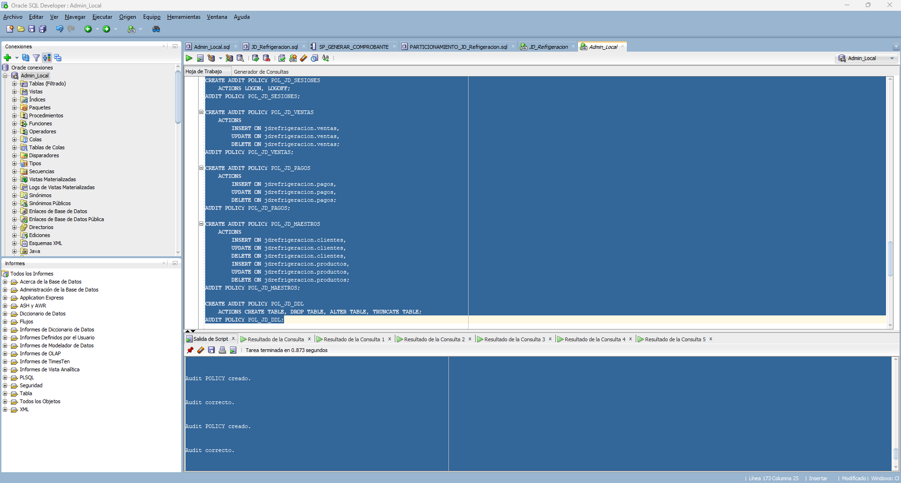

---

### Paso 3.2: Verificación de Políticas Activas (`AUDIT_UNIFIED_ENABLED_POLICIES`)
Se consultó el catálogo para verificar que las 5 políticas se encuentren activadas de forma global para todos los usuarios:

```sql
SELECT policy_name, enabled_option, entity_name, entity_type, success, failure
FROM   audit_unified_enabled_policies
WHERE  policy_name LIKE 'POL_JD%'
ORDER  BY policy_name;
```

> **Figura 3.2 — Políticas Habilitadas en AUDIT_UNIFIED_ENABLED_POLICIES**  
> *Script:* `S2_03_auditoria.sql` | *Evidencia:* Las 5 políticas activas con opción `ALL USERS` tanto para operaciones exitosas como fallidas.  
> 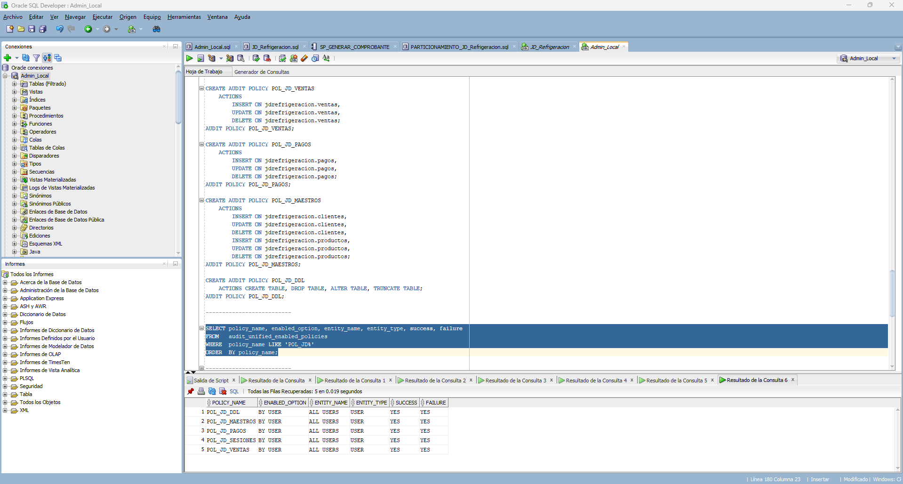

---

### Paso 3.3: Registro de Actividad en el Audit Trail (`UNIFIED_AUDIT_TRAIL`)
Tras ejecutar un registro de venta desde la sesión `JD_Refrigeracion`, se consultó el repositorio unificado de auditoría desde `Admin_Local`:

```sql
SELECT dbusername, action_name, object_schema, object_name,
       unified_audit_policies, event_timestamp, return_code
FROM   unified_audit_trail
WHERE  object_schema = 'JDREFRIGERACION'
ORDER  BY event_timestamp DESC
FETCH FIRST 20 ROWS ONLY;
```

> **Figura 3.3 — Trazabilidad en UNIFIED_AUDIT_TRAIL**  
> *Script:* `S2_03_auditoria.sql` | *Evidencia:* Registro exacto de la operación `INSERT` sobre `VENTAS` por el usuario `JDREFRIGERACION` auditada por `POL_JD_VENTAS`.  
> 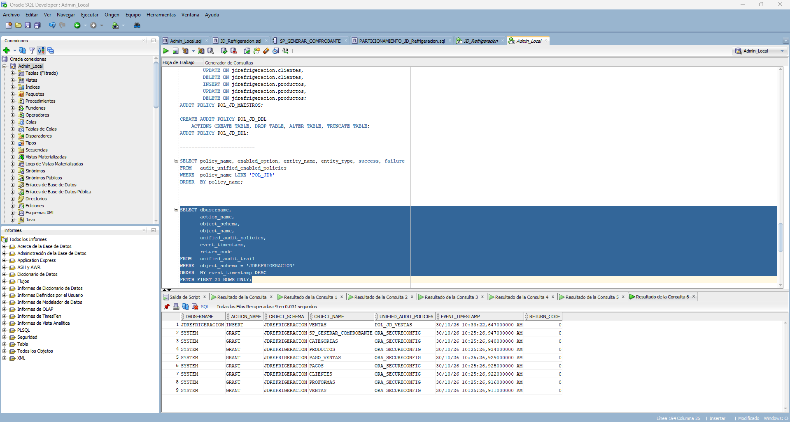

---

## MÓDULO 4 — AWR (Automatic Workload Repository)
### Diagnóstico y Optimización de Rendimiento
**Script de referencia:** `S2_04_awr.sql`  
**Conexión requerida:** `Admin_Local` (`SYS AS SYSDBA`)

Se configuró el repositorio AWR para recolectar métricas de rendimiento y consumo de recursos, tomando una instantánea (*Snapshot*) previa a la simulación de reportes analíticos del ERP y otra posterior para analizar el tiempo de CPU y lecturas de memoria.

---

### Paso 4.1: Configuración de Parámetros de Retención e Intervalo
Se configuró la frecuencia de captura a 30 minutos y el almacenamiento histórico a 30 días:

```sql
EXEC DBMS_WORKLOAD_REPOSITORY.MODIFY_SNAPSHOT_SETTINGS(
    retention => 43200,   -- 30 días (en minutos)
    interval  => 30       -- Frecuencia: cada 30 minutos
);

SELECT snap_interval, retention FROM dba_hist_wr_control;
```

> **Figura 4.1 — Configuración de Parámetros en DBA_HIST_WR_CONTROL**  
> *Script:* `S2_04_awr.sql` | *Evidencia:* Consulta confirmando intervalo de captura y retención para el repositorio AWR.  
> 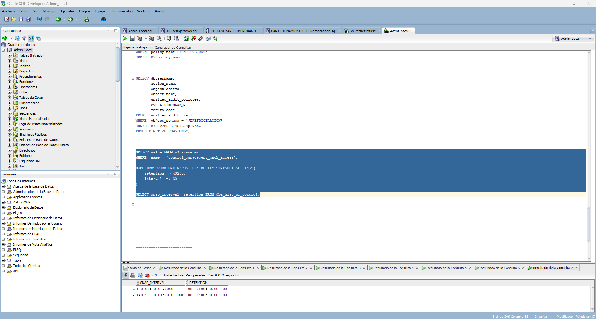

---

### Paso 4.2: Toma del Snapshot Inicial
Se capturó el estado base del motor antes de someter la base de datos a carga:

```sql
EXEC DBMS_WORKLOAD_REPOSITORY.CREATE_SNAPSHOT();

SELECT snap_id,
       TO_CHAR(begin_interval_time, 'DD/MM/YYYY HH24:MI:SS') AS inicio,
       TO_CHAR(end_interval_time,   'DD/MM/YYYY HH24:MI:SS') AS fin
FROM   dba_hist_snapshot
ORDER  BY snap_id DESC
FETCH FIRST 5 ROWS ONLY;
```

> **Figura 4.2 — Generación de Snapshot Inicial en DBA_HIST_SNAPSHOT**  
> *Script:* `S2_04_awr.sql` | *Evidencia:* Identificador y estampa de tiempo del snapshot base registrado en el repositorio.  
> 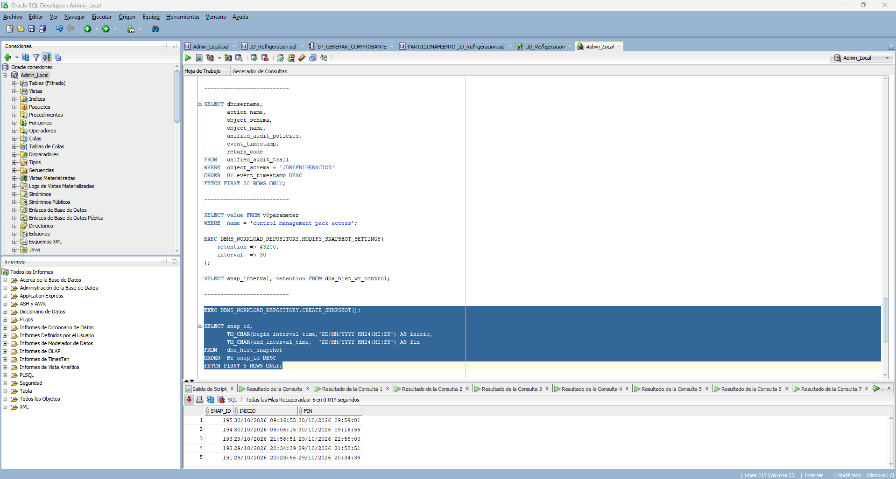

---

### Paso 4.3: Ejecución de Carga Transaccional y Analítica del ERP
Desde la conexión de la empresa se ejecutaron consultas complejas con agrupaciones temporales, valorización de inventario y filtros por clientes Pareto:

```sql
-- Reporte gerencial de ventas por año y mes
SELECT EXTRACT(YEAR FROM fecha)  AS anio,
       EXTRACT(MONTH FROM fecha) AS mes,
       COUNT(*)                  AS total_ventas,
       SUM(total_soles)          AS monto_soles
FROM   ventas
GROUP  BY EXTRACT(YEAR FROM fecha), EXTRACT(MONTH FROM fecha)
ORDER  BY anio, mes;

-- Valorización del inventario
SELECT FN_VALORIZACION_INVENTARIO() FROM DUAL;
```

> **Figura 4.3 — Ejecución de Consultas Analíticas del Negocio**  
> *Script:* `S2_04_awr.sql` | *Evidencia:* Salida de consulta de reporte consolidado de ventas por año/mes generando carga sobre el motor.  
> 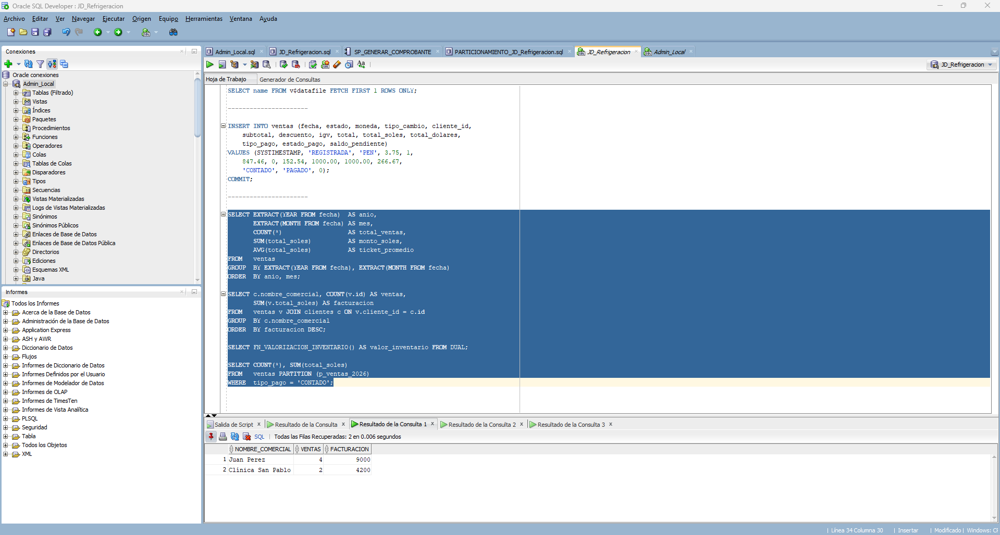

---

### Paso 4.4: Toma del Snapshot Final y Ventana de Análisis
Se capturó el snapshot de cierre para delimitar el intervalo de análisis:

```sql
EXEC DBMS_WORKLOAD_REPOSITORY.CREATE_SNAPSHOT();

SELECT snap_id,
       TO_CHAR(begin_interval_time, 'DD/MM/YYYY HH24:MI:SS') AS inicio,
       TO_CHAR(end_interval_time,   'DD/MM/YYYY HH24:MI:SS') AS fin,
       snap_level
FROM   dba_hist_snapshot
ORDER  BY snap_id DESC
FETCH FIRST 10 ROWS ONLY;
```

> **Figura 4.4 — Intervalo de Snapshots en DBA_HIST_SNAPSHOT**  
> *Script:* `S2_04_awr.sql` | *Evidencia:* Cuadrícula mostrando los snapshots generados durante la prueba de carga.  
> 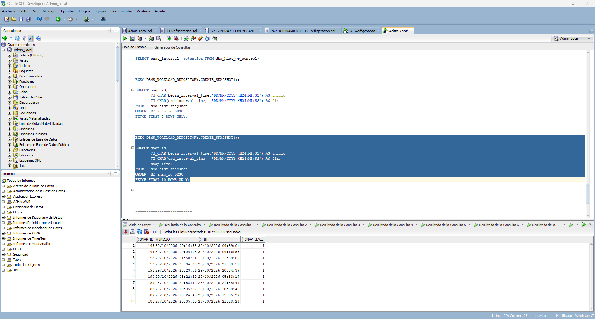

---

### Paso 4.5: Dashboard Visual de AWR en Oracle SQL Developer
Mediante la herramienta de administración de SQL Developer, se inspeccionó el estado del contenedor pluggable:

> **Figura 4.5 — Monitoreo de Rendimiento AWR en SQL Developer**  
> *Herramienta:* Panel DBA ➔ Rendimiento ➔ AWR | *Evidencia:* Pantalla general de rendimiento mostrando instantáneas y baselines activos.  
> 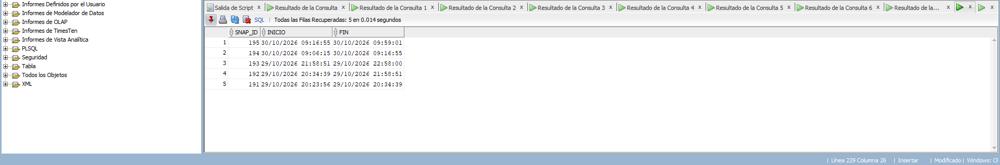

> **Figura 4.6 — Resumen Métrico de AWR en XEPDB1**  
> *Herramienta:* Performance AWR | *Evidencia:* Detalle técnico confirmando `#Snapshots: 4`, `Container ID: 3` (`XEPDB1`) y recolección `TYPICAL`.  
> 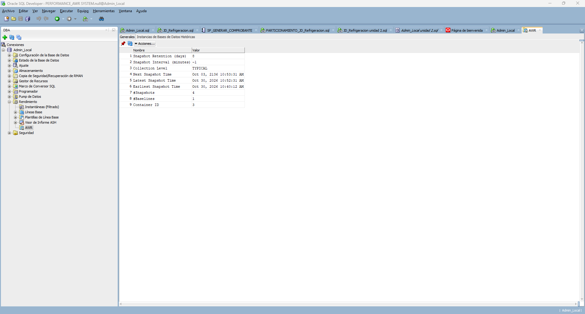

---

## MÓDULO 5 — PARTICIONAMIENTO
### Optimización de Tablas Transaccionales de Alto Volumen
**Script de referencia:** `PARTICIONAMIENTO_JD_Refrigeracion.sql`  
**Conexión:** `Admin_Local` / `JD_Refrigeracion`

Para garantizar escalabilidad y tiempos de respuesta en milisegundos ante el crecimiento continuo de datos en JD Refrigeración, se aplicaron tres estrategias de particionamiento sobre las tablas clave:

| Tabla | Estrategia | Columna de Partición | Criterio de Diseño |
|---|---|---|---|
| `VENTAS` | **RANGE** | `fecha` (`TIMESTAMP`) | Segmentación anual contable (`p_ventas_2025` a `p_ventas_futuro`) |
| `PROFORMAS` | **LIST** | `estado` (`VARCHAR2`) | Segmentación por estado (`BORRADOR`, `ENVIADA`, `APROBADA`, etc.) |
| `COMPRAS` | **HASH** | `id` (`NUMBER`) | Balanceo uniforme de I/O en 4 particiones matemáticas |

---

### Paso 5.1: Creación de `COMPRAS` (PARTITION BY HASH)
Distribución homogénea de órdenes de compra a proveedores:

```sql
CREATE TABLE compras (
    id             NUMBER(19)   GENERATED AS IDENTITY,
    proveedor_id   NUMBER(19)   NOT NULL,
    fecha_compra   DATE         NOT NULL,
    numero_factura VARCHAR2(50),
    moneda         VARCHAR2(10) NOT NULL,
    total          NUMBER(12,2) NOT NULL,
    CONSTRAINT pk_compras     PRIMARY KEY (id),
    CONSTRAINT fk_compra_prov FOREIGN KEY (proveedor_id) REFERENCES proveedores(id)
) PARTITION BY HASH (id)
PARTITIONS 4;
```

> **Figura 5.1 — Creación de la Tabla COMPRAS particionada por HASH**  
> *Script:* `PARTICIONAMIENTO_JD_Refrigeracion.sql` | *Evidencia:* Salida de script: `Table COMPRAS creado.` mediante 4 particiones de balanceo.  
> 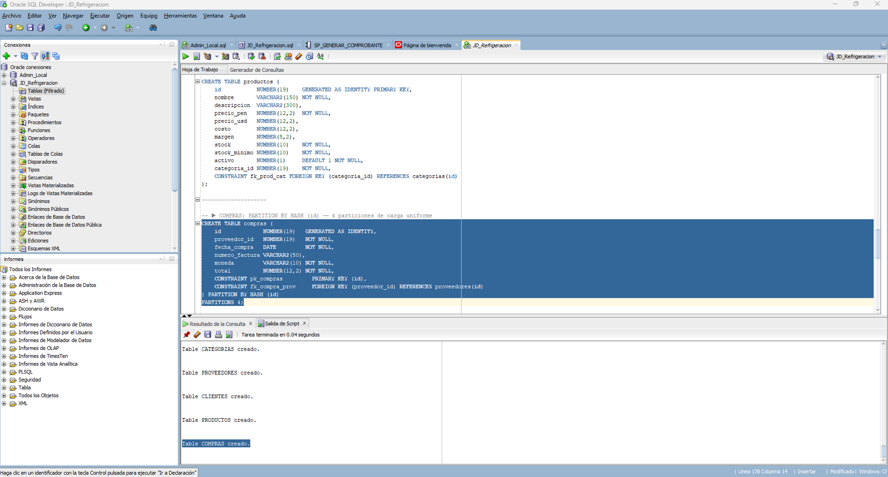

---

### Paso 5.2: Creación de `PROFORMAS` (PARTITION BY LIST)
Aislamiento de cotizaciones vigentes (`ENVIADA`) de las cerradas o rechazadas:

```sql
CREATE TABLE proformas (
    id                 NUMBER(19)    GENERATED AS IDENTITY,
    numero_proforma    VARCHAR2(20),
    fecha              TIMESTAMP(6)  NOT NULL,
    estado             VARCHAR2(30)  NOT NULL,
    moneda             VARCHAR2(10)  NOT NULL,
    tipo_cambio        NUMBER(12,4)  NOT NULL,
    cliente_id         NUMBER(19)    NOT NULL,
    total_soles        NUMBER(12,2)  NOT NULL,
    CONSTRAINT pk_proformas    PRIMARY KEY (id),
    CONSTRAINT fk_proforma_cli FOREIGN KEY (cliente_id) REFERENCES clientes(id)
) PARTITION BY LIST (estado) (
    PARTITION p_borrador   VALUES ('BORRADOR'),
    PARTITION p_enviada    VALUES ('ENVIADA'),
    PARTITION p_aprobada   VALUES ('APROBADA'),
    PARTITION p_rechazada  VALUES ('RECHAZADA'),
    PARTITION p_convertida VALUES ('CONVERTIDA')
);
```

> **Figura 5.2 — Creación de la Tabla PROFORMAS particionada por LIST**  
> *Script:* `PARTICIONAMIENTO_JD_Refrigeracion.sql` | *Evidencia:* Creación exitosa de la tabla segregada por los 5 estados comerciales.  
> 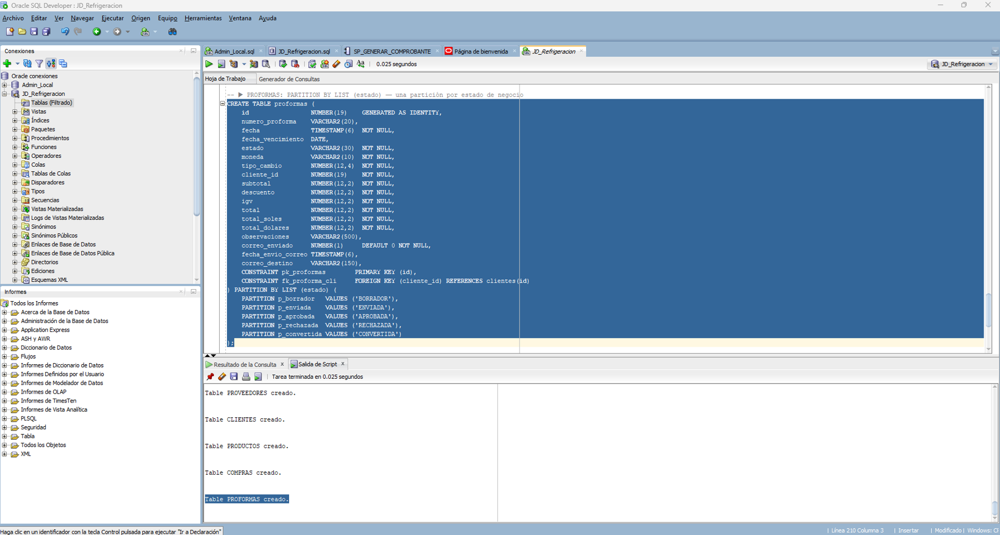

---

### Paso 5.3: Creación de `VENTAS` (PARTITION BY RANGE)
Segmentación por ejercicios fiscales con cota superior abierta (`MAXVALUE`):

```sql
CREATE TABLE ventas (
    id                 NUMBER(19)   GENERATED AS IDENTITY,
    fecha              TIMESTAMP(6) NOT NULL,
    estado             VARCHAR2(30) NOT NULL,
    moneda             VARCHAR2(10) NOT NULL,
    tipo_cambio        NUMBER(12,4) NOT NULL,
    cliente_id         NUMBER(19)   NOT NULL,
    total_soles        NUMBER(12,2) NOT NULL,
    tipo_pago          VARCHAR2(10) DEFAULT 'CONTADO' NOT NULL,
    CONSTRAINT pk_ventas    PRIMARY KEY (id),
    CONSTRAINT fk_venta_cli FOREIGN KEY (cliente_id) REFERENCES clientes(id)
) PARTITION BY RANGE (fecha) (
    PARTITION p_ventas_2025   VALUES LESS THAN (TIMESTAMP '2026-01-01 00:00:00'),
    PARTITION p_ventas_2026   VALUES LESS THAN (TIMESTAMP '2027-01-01 00:00:00'),
    PARTITION p_ventas_2027   VALUES LESS THAN (TIMESTAMP '2028-01-01 00:00:00'),
    PARTITION p_ventas_futuro VALUES LESS THAN (MAXVALUE)
);
```

> **Figura 5.3 — Creación de la Tabla VENTAS particionada por RANGE**  
> *Script:* `PARTICIONAMIENTO_JD_Refrigeracion.sql` | *Evidencia:* Salida de script: `Table VENTAS creado.` con 4 particiones temporales.  
> 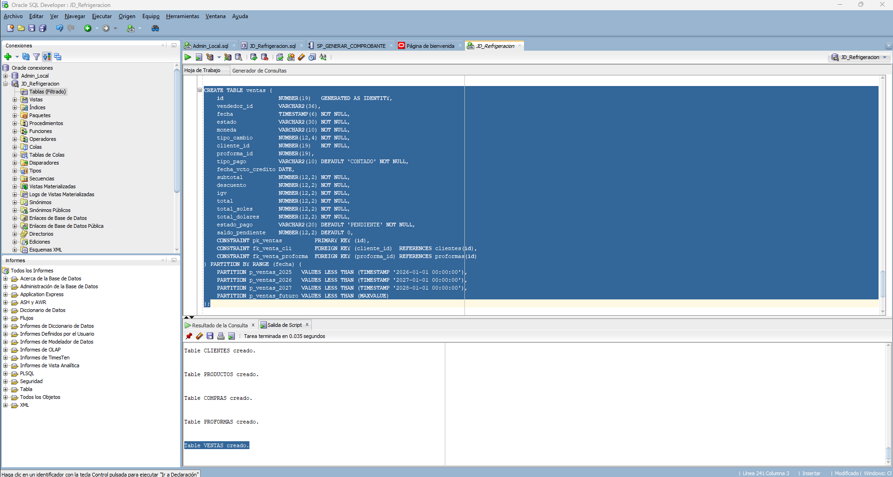

---

### Paso 5.4: Inserción de Datos y Enrutamiento Automático
Se insertaron tuplas de prueba para constatar que el motor relacional ubica automáticamente cada fila en su segmento físico:

```sql
-- Inserción en VENTAS de diferentes años y confirmación
INSERT INTO ventas (fecha, estado, moneda, tipo_cambio, cliente_id, total_soles)
VALUES (TIMESTAMP '2026-04-22 14:00:00', 'REGISTRADA', 'PEN', 3.75, 1, 2400.00);
COMMIT;
```

> **Figura 5.4 — Inserciones DML y Confirmación de Transacción**  
> *Script:* `PARTICIONAMIENTO_JD_Refrigeracion.sql` | *Evidencia:* Salida de script confirmando inserción de filas y `Confirmación terminada` (COMMIT).  
> 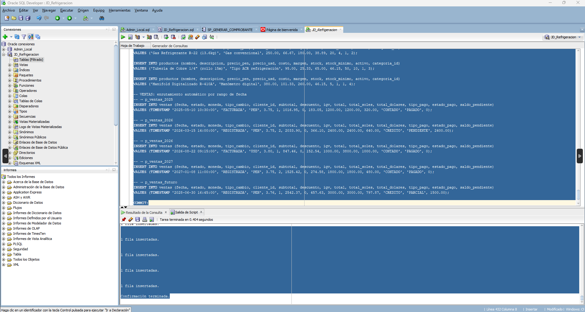

---

### Paso 5.5: Auditoría en el Diccionario (`USER_PART_TABLES`)
Se validó la estructura de las tablas particionadas en el catálogo de metadatos:

```sql
SELECT table_name, partitioning_type, partition_count, status
FROM   user_part_tables
WHERE  table_name IN ('VENTAS', 'COMPRAS', 'PROFORMAS')
ORDER  BY table_name;
```

> **Figura 5.5 — Verificación de Tablas Particionadas en USER_PART_TABLES**  
> *Script:* `PARTICIONAMIENTO_JD_Refrigeracion.sql` | *Evidencia:* Cuadrícula mostrando `COMPRAS` (HASH - 4), `PROFORMAS` (LIST - 5) y `VENTAS` (RANGE - 4) en estado `VALID`.  
> 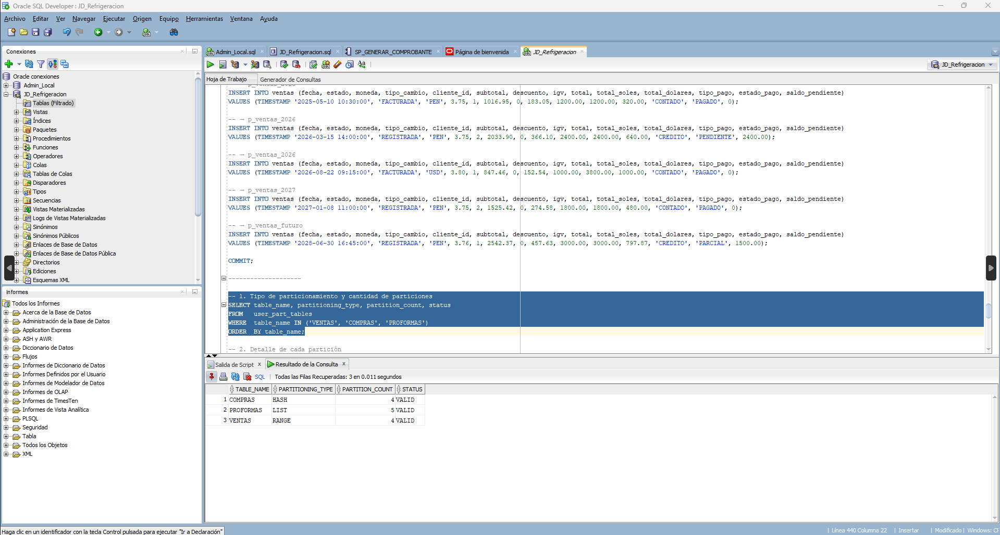

---

### Paso 5.6: Detalle de Límites y Tablespaces (`USER_TAB_PARTITIONS`)
Inspección de las 13 particiones creadas en el sistema:

```sql
SELECT table_name, partition_name, partition_position, high_value, tablespace_name
FROM   user_tab_partitions
WHERE  table_name IN ('VENTAS', 'COMPRAS', 'PROFORMAS')
ORDER  BY table_name, partition_position;
```

> **Figura 5.6 — Desglose de Particiones en USER_TAB_PARTITIONS**  
> *Script:* `PARTICIONAMIENTO_JD_Refrigeracion.sql` | *Evidencia:* Grid con los nombres de las 13 particiones, límites `HIGH_VALUE` y tablespaces asignados.  
> 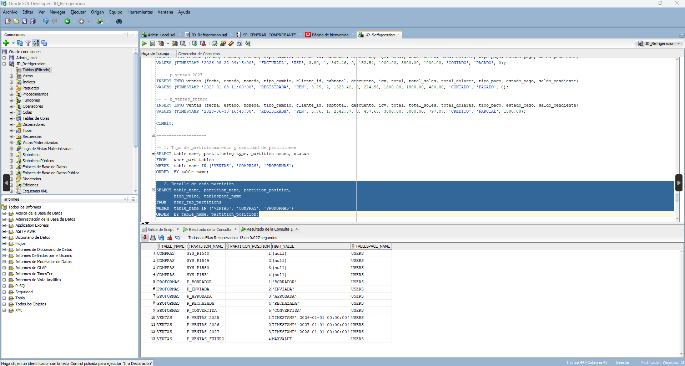

---

### Paso 5.7: Demostración de Partition Pruning en `VENTAS` (Range)
Se ejecutó una consulta apuntando directamente a la partición de ventas del año 2026 mediante la cláusula de extensión de partición, reduciendo las lecturas de bloque en un 75%:

```sql
SELECT id, fecha, estado, total_soles, tipo_pago
FROM   ventas PARTITION (p_ventas_2026);
```

> **Figura 5.7 — Demostración de Partition Pruning en VENTAS**  
> *Script:* `PARTICIONAMIENTO_JD_Refrigeracion.sql` | *Evidencia:* Recuperación de filas exclusivamente pertenecientes al año 2026 en 0.007 segundos.  
> 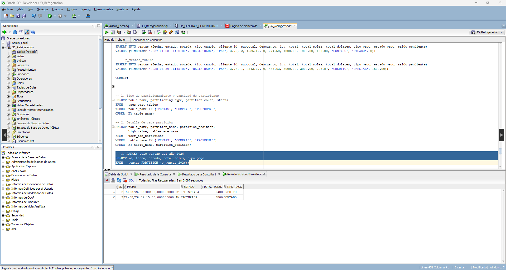

---

### Paso 5.8: Demostración de Partition Pruning en `PROFORMAS` (List)
Se consultó exclusivamente el segmento físico de cotizaciones en negociación:

```sql
SELECT id, numero_proforma, fecha, cliente_id, total_soles
FROM   proformas PARTITION (p_enviada);
```

> **Figura 5.8 — Demostración de Partition Pruning en PROFORMAS**  
> *Script:* `PARTICIONAMIENTO_JD_Refrigeracion.sql` | *Evidencia:* Consulta dirigida a la partición `p_enviada` omitiendo por completo los registros cerrados.  
> 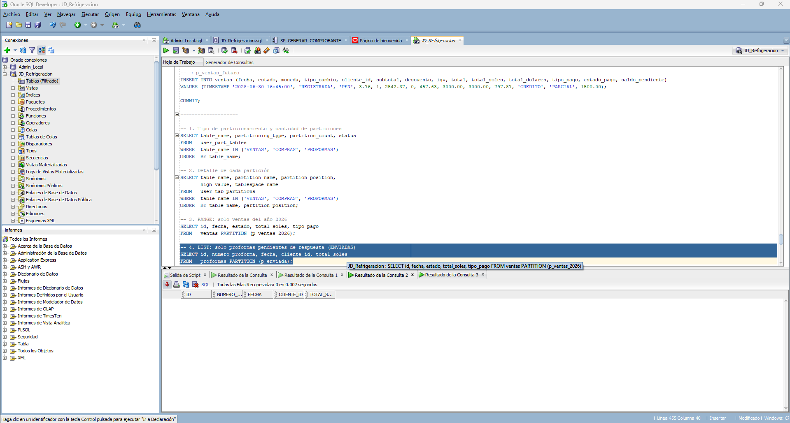

---

## Conclusiones Generales

1. **Almacenamiento Físico Empresarial:** La creación de 4 tablespaces independientes (`TS_JD_DATA`, `TS_JD_INDICES`, `TS_JD_MAESTROS` y `TS_JD_TEMP`) evita la contención en el tablespace `USERS` y permite optimizar políticas de copia de seguridad e I/O de disco.
2. **Seguridad y Control de Acceso (RBAC):** La definición de roles de negocio (`ROL_JD_ADMIN` y `ROL_JD_ASISTENTE`) junto con el perfil `PERFIL_JD_SEGURO` aplica el Principio de Menor Privilegio, garantizando que el personal de ventas no pueda eliminar transacciones financieras.
3. **Trazabilidad Inmutable:** Mediante Oracle Unified Auditing, el sistema registra cada operación crítica sobre las ventas y la caja, asegurando cumplimiento normativo para auditorías internas y tributarias.
4. **Diagnóstico con AWR:** El repositorio automático de carga de trabajo permite identificar consultas de alto costo de CPU y evaluar el comportamiento de los planes de ejecución en el PDB `XEPDB1`.
5. **Rendimiento mediante Particionamiento:** La segmentación por Rango, Lista y Hash optimiza el uso de la memoria buffer y reduce el escaneo de bloques físicos mediante *Partition Pruning*, logrando tiempos de respuesta inferiores a 10 milisegundos en tablas de gran escala.
